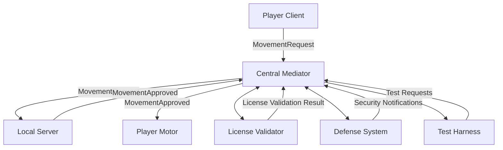
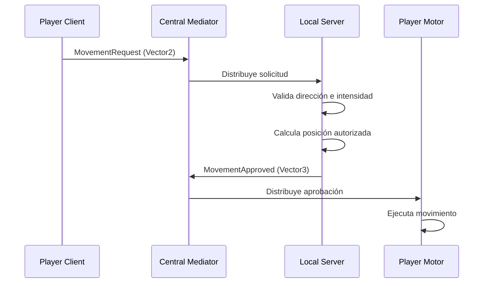

# Project Sentinel

**Local Authoritative Server Simulation · Unity 6 · C#**

Project Sentinel es un prototipo desarrollado en Unity 6 cuyo objetivo es implementar una arquitectura de seguridad para videojuegos mediante el patrón de diseño **Mediator**, simulación de un servidor autoritativo local, validación de parámetros, protección de licencias y técnicas de ofuscación de código.

El proyecto simula un entorno controlado donde las acciones del jugador son procesadas y validadas por un servidor local antes de ser ejecutadas.

---

## Objetivos del proyecto

- Implementar el patrón Mediator para establecer una comunicación desacoplada entre los diferentes sistemas.
- Simular una arquitectura cliente-servidor con autoridad centralizada.
- Validar las solicitudes de movimiento y corregir parámetros fuera de los límites permitidos.
- Implementar un sistema de validación de licencias mediante transporte ofuscado.
- Incorporar mecanismos de detección de anomalías y respuestas de seguridad.
- Aplicar técnicas de ofuscación estructural para dificultar el análisis estático.
- Desarrollar un entorno de pruebas para demostrar los diferentes escenarios de seguridad.

## Tecnologías

| Tecnología | Uso |
|---|---|
| Unity 6 | Motor de desarrollo |
| C# | Lenguaje de programación |
| New Input System | Gestión de entradas |
| Rigidbody | Física y movimiento |
| Mediator Pattern | Comunicación desacoplada |
| Mermaid | Documentación de arquitectura |

---

## Arquitectura del sistema

El proyecto utiliza un Mediador Central como único canal de comunicación entre los diferentes subsistemas.

Ningún módulo debe invocar directamente los métodos de otro. Las solicitudes, respuestas y notificaciones se distribuyen mediante mensajes gestionados por el Mediador.

### Diagrama general



### Flujo de movimiento



### Responsabilidades de los módulos

| Módulo | Responsabilidad |
|---|---|
| PlayerClient | Captura las entradas del jugador y envía intenciones de movimiento. |
| CentralMediator | Gestiona la comunicación entre todos los subsistemas. |
| LocalServer | Valida solicitudes y mantiene el estado autoritativo del jugador. |
| PlayerMotor | Ejecuta exclusivamente los movimientos autorizados. |
| LicenseValidator | Gestiona la validación de la licencia del juego. |
| DefenseSystem | Detecta anomalías y ejecuta respuestas de seguridad. |
| TestHarness | Permite ejecutar y visualizar escenarios de prueba. |

---

## Estructura del proyecto

```text
Assets/
└── _Project/
    ├── Art/
    ├── Materials/
    ├── Prefabs/
    ├── Scenes/
    │   └── SecurityLab.unity
    ├── Scripts/
    │   ├── Core/
    │   │   ├── IMediator.cs
    │   │   ├── CentralMediator.cs
    │   │   └── Messages/
    │   │       ├── MovementRequest.cs
    │   │       ├── MovementApproved.cs
    │   │       └── MovementRejected.cs
    │   │
    │   ├── Player/
    │   │   ├── PlayerClient.cs
    │   │   └── PlayerMotor.cs
    │   │
    │   ├── Server/
    │   │   └── LocalServer.cs
    │   │
    │   ├── Security/
    │   │   ├── LicenseValidator.cs
    │   │   └── ObfuscatedValidator.cs
    │   │
    │   ├── Defense/
    │   │   └── DefenseSystem.cs
    │   │
    │   └── Testing/
    │       ├── TestHarness.cs
    │       └── MediatorTest.cs
    │
    └── UI/
```

*La estructura representa la organización objetivo del proyecto; los módulos todavía pendientes se incorporarán durante el desarrollo.*

---

## Sistemas principales

### 1. Central Mediator

Implementación del patrón Mediator mediante una interfaz `IMediator`.

Responsabilidades:
- Registrar suscriptores.
- Distribuir mensajes según su tipo.
- Permitir la comunicación desacoplada.
- Evitar referencias directas entre subsistemas.

### 2. Local Authoritative Server

Simulación de un servidor local que controla las acciones del jugador.

Responsabilidades:
- Recibir intenciones de movimiento.
- Validar los parámetros recibidos.
- Calcular posiciones autorizadas.
- Rechazar o corregir solicitudes inválidas.

### 3. License Validation

Sistema encargado de verificar la integridad de la licencia.

Características previstas:
- Transporte ofuscado de la llave.
- Reconstrucción durante la validación.
- Comprobación criptográfica.
- Respuesta silenciosa ante licencias inválidas.

### 4. Defense System

Sistema de seguridad encargado de responder ante comportamientos anómalos.

Posibles respuestas:
- Corrección forzada de parámetros.
- Penalizaciones al jugador.
- Alteraciones del entorno.
- Sabotajes dentro de la experiencia.

### 5. Code Obfuscation

Implementación de técnicas de ofuscación estructural:

- Invariantes matemáticos y ramas inalcanzables.
- Máquinas de estados mediante `switch-case`.
- Estructuras iterativas con condiciones de salida controladas.

---

## Escenarios de prueba

El proyecto contempla tres escenarios principales:

| Escenario | Resultado esperado |
|---|---|
| Operación legítima | El servidor acepta las solicitudes y el juego funciona normalmente. |
| Manipulación de parámetros | El servidor detecta anomalías y corrige los valores. |
| Licencia inválida | Se activa una respuesta de seguridad silenciosa sin interrumpir el programa. |

---

## Estado de desarrollo

- [x] Creación del proyecto Unity 6.
- [x] Configuración del New Input System.
- [x] Movimiento mediante teclado.
- [x] Compatibilidad con Gamepad.
- [x] Interfaz `IMediator`.
- [x] Implementación inicial de `CentralMediator`.
- [x] Prueba de comunicación mediante mensajes.
- [ ] Implementación completa del flujo de movimiento mediante el Mediador.
- [ ] Validación y reconciliación del servidor.
- [ ] Sistema de licencias.
- [ ] Sistema de defensa y sabotaje.
- [ ] Ofuscación estructural.
- [ ] Test Harness y escenarios de demostración.

---

## Limitaciones

Project Sentinel utiliza un servidor simulado dentro del mismo ejecutable. Por lo tanto, no representa una arquitectura de seguridad real frente a un atacante que tenga control sobre el cliente.

La ofuscación tampoco sustituye mecanismos criptográficos adecuados. El objetivo es demostrar los conceptos de arquitectura, validación, integridad y seguridad en un entorno académico controlado.

---

## Project Information

**Project:** Project Sentinel  
**Engine:** Unity 6  
**Language:** C#  
**Platform:** PC  
**Architecture:** Mediator Pattern + Local Authoritative Server  
**Type:** Academic Security Prototype

---

*Project Sentinel — Validating every action. Trusting no input.*